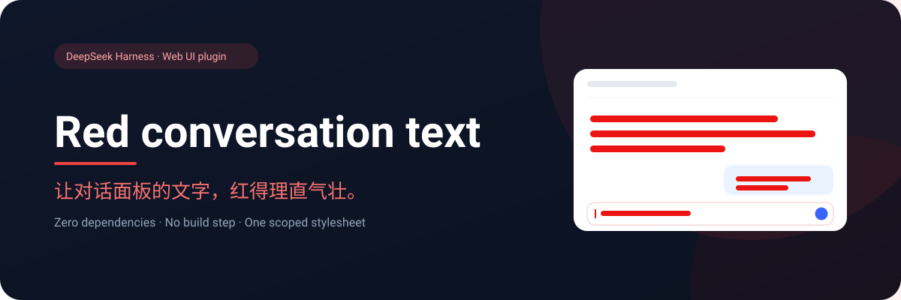
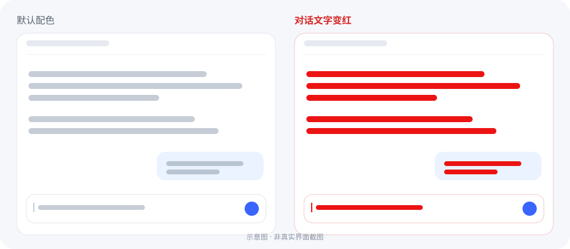
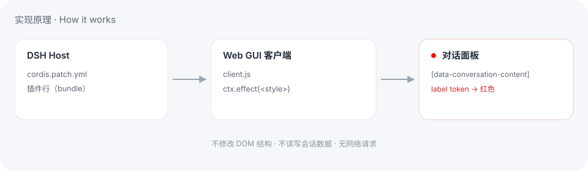

# Red conversation text · 对话文字变红

**让 DeepSeek Harness 的对话面板，红得理直气壮。**
一个零依赖的 DSH Web GUI 插件：一段作用域样式，就能把对话面板里的文字全部调成红色。

> 仓库代号 **red-alert**，灵感来自《红色警戒》（Red Alert）：给你的对话面板拉响最高级别的红色警报。

[](LICENSE)


[中文](#中文) · [English](#english) · [安装](#安装) · [自定义](#自定义) · [常见问题](#常见问题)

---

## 中文

### 先说结论

- 🎯 **做什么** — 把 DSH 对话面板里的文字变成红色：消息、输入框、欢迎语。
- 🪶 **多轻** — 零依赖、无构建、无 Host 逻辑，只有一段作用域样式。
- 🙈 **多安全** — 不读写会话数据、不发网络请求、不改 DOM 结构。
- 🎨 **多可控** — 换颜色或缩小范围，改一个 token / 一个选择器。

### 一眼看效果



| 变红 | 保持原样 |
| --- | --- |
| 你的消息、助手的回复 | 代码块里的语法高亮 token |
| 输入框文字与光标 | 侧边栏、对话标题栏、右栏 |
| 新会话欢迎语、面板内联菜单 | portal 到 `body` 的宿主浮层 |

红色不是写死的色值：它取主题的 `--dsw-alias-state-error-primary`（浅色 red-600 / 深色 red-400），
所以浅色、深色主题都不需要额外配置。

### 安装

1. 打开 **设置 → 插件 → 添加插件**；
2. 填入本仓库在本机的绝对路径：
   ```
   /Users/you/code/dsh-red-dialog-text
   ```
   也可以直接填 GitHub 地址：
   ```
   https://github.com/ShaohonChen/red-alert
   ```
3. 装好后插件列表里会出现「**对话文字变红 / Red conversation text**」。
   如果页面还没变化，按 `⌘R`（Windows `Ctrl+R`）刷新一次。

> 小提示：以本地目录安装时，改完 CSS 刷新页面即可生效，不需要重新安装。

### 停用与卸载

- **暂时关掉**：设置 → 插件 → 「对话文字变红」的开关关闭，文字立刻恢复原色。
- **彻底移除**：进入插件详情页 → 右上角「卸载」。

### 为什么做它？

有时候你只是想让对话更抢眼——录屏、截图、演示，或者单纯想给 DSH 换个心情。
它不接管你的会话，也不改变布局，只做一件事：**把颜色换成红色**。

> 副作用警告：可能会开始觉得红色才是正常配色。

### 工作原理



- Host 半边（[index.js](index.js)）是空的，只负责让插件行加载客户端模块；
- 客户端（[client.js](client.js)）在 `apply` 里用 `ctx.effect` 注入一段 `<style>`，停用 / 卸载时自动移除；
- 样式只在 `[data-conversation-content]` 子树里把 label 系列 token 指向主题错误红，并给编辑区加红色光标；
- 没有事件监听、没有定时器、没有网络请求。

### 自定义

改 [client.js](client.js) 里 `CSS` 字符串即可，几个常见玩法：

| 想要 | 改法 |
| --- | --- |
| 换颜色 | 把 `var(--dsw-alias-state-error-primary)` 换成其他 `--dsw-alias-*` token 或色值 |
| 只让聊天消息变红 | 选择器换成 `[data-conversation-region="chat"]` |
| 只让输入框变红 | 选择器换成 `[data-conversation-region="composer"]` |
| 关掉红色光标 | 删掉 `caret-color` 那条规则 |

```css
/* 例子：只让聊天消息变红 */
html body [data-conversation-region="chat"] {
  --dsw-alias-label-primary: var(--dsw-alias-state-error-primary);
  color: var(--dsw-alias-state-error-primary);
}
```

### 常见问题

<details>
<summary>安装后没有变红？</summary>

先刷新页面（`⌘R`）。仍然不行就确认插件处于启用状态；再不行，把 DSH 版本和插件列表截图发个 Issue。
</details>

<details>
<summary>会不会拖慢界面？</summary>

不会。只有一条静态 CSS，没有 JS 监听器、没有轮询。
</details>

<details>
<summary>会读取我的聊天内容吗？</summary>

不会。插件不访问会话数据，也不发任何网络请求。
</details>

<details>
<summary>代码块为什么没全红？</summary>

语法高亮 token 保留自己的配色，读起来才有层次；普通代码文字会跟着变红。
</details>

### 兼容性

- 依赖 DSH Web GUI 上的两个稳定钩子：`data-conversation-content` 容器和 `--dsw-alias-*` 主题 token。
- 在 DSH `0.2.2-rc.5`（macOS Desktop）上开发，其他版本未逐一测试。
- 如果 DSH 改了上述钩子，插件可能失效，需要更新选择器。

### 开发

| 文件 | 作用 |
| --- | --- |
| [package.json](package.json) | 包声明：组合包 patch、`dsh.client` 入口、导出与文件清单 |
| [cordis.patch.yml](cordis.patch.yml) | 把插件行插入当前 profile |
| [index.js](index.js) | Host 半边（空实现） |
| [client.js](client.js) | 客户端半边：注入作用域样式 |
| [locale/zh.json](locale/zh.json) / [locale/en.json](locale/en.json) | 插件管理器里的标题与说明 |
| [icon.svg](icon.svg) | 插件图标（36×36） |
| [docs/](docs) | README 配图：banner、效果对比、实现原理示意图 |
| [LICENSE](LICENSE) | 许可证 |

提交前快速自检：

```sh
node --check client.js
node -e "JSON.parse(require('fs').readFileSync('package.json','utf8'))"
xmllint --noout icon.svg docs/*.svg   # 可选
```

欢迎 Issue / PR。想加「只让标题变红」「彩虹渐变」之类的玩法？改一个 token 就能提 PR。

### 许可证

[The Unlicense](LICENSE)：公有领域，复制、修改、商用、再发布都不需要署名。

如果它让你的截图更好看了，点个 Star ⭐ 就是最好的鼓励。

---

## English

**Paint the DeepSeek Harness conversation red.**
A zero-dependency DSH Web GUI plugin — one scoped stylesheet, no build step, no settings.

> Repo codename **red-alert**, after the Red Alert series: sound the highest-level red alarm on your conversation pane.


### What it does

Turns the body text inside the DSH conversation pane red — your messages, the
assistant's messages, the composer, and the empty-session greeting. The red uses
the theme's `--dsw-alias-state-error-primary` token, so light and dark themes are
both covered. Highlighted code tokens keep their syntax colors; the sidebar,
conversation header, right column, and portalled surfaces keep the host palette.

### Install

1. Open **Settings → Plugins → Add plugin**;
2. enter this repository's absolute path, or
   `https://github.com/ShaohonChen/red-alert`;
3. keep **Red conversation text** enabled. Refresh the page (`⌘R`) if the recolor
   does not show up immediately.

To turn it off, use the plugin's enable switch; to remove it, uninstall from the
plugin's detail page.

### How it works


- The Host half is an empty `apply()` — it only lets the plugin row load the client module.
- The client injects one `<style>` inside `ctx.effect` and removes it on unload.
- The stylesheet recolors label tokens under `[data-conversation-content]` and adds a red caret.
- No session access, no network, no DOM mutation, no timers.

### Make it yours

Edit the `CSS` string in [client.js](client.js):

| Want | Change |
| --- | --- |
| Another color | Swap `var(--dsw-alias-state-error-primary)` for another `--dsw-alias-*` token or a literal color |
| Only chat messages red | Use the selector `[data-conversation-region="chat"]` |
| Only the composer red | Use the selector `[data-conversation-region="composer"]` |
| No red caret | Drop the `caret-color` rule |

### Compatibility

Built against DSH `0.2.2-rc.5` (macOS Desktop); other versions were not tested
one by one. It relies on the `data-conversation-content` container and the
`--dsw-alias-*` theme tokens, so a host release that changes those hooks may
require a selector update.

### License

[The Unlicense](LICENSE) — public domain. Use, modify, sell, and redistribute
freely, with no attribution required.
